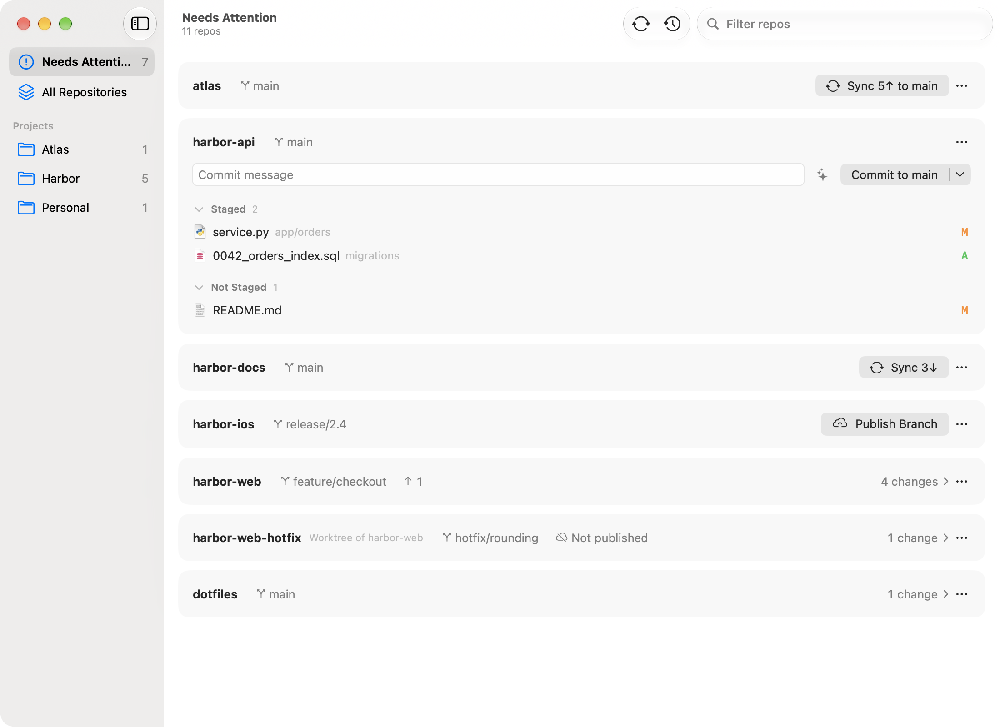

# Ferry

[](LICENSE)
[](#requirements)
[](https://github.com/Fynnius/Ferry/releases/latest)

Every git repo that needs you, in one calm Mac window. Write a message, commit, push — without opening an editor.

Ferry is a small native macOS app for the part of a code editor's Source Control panel you actually use, across all your repositories at once. It drives the git you already have, so your hooks, credentials, signing and settings just work.

<p align="center">
  <picture>
    <source media="(prefers-color-scheme: dark)" srcset="docs/screenshot-dark.png" />
    
  </picture>
</p>

## Features

- **One list of what needs you.** Repos with changes, commits to push or pull, an unpublished branch or a merge in progress rise to the top; clean repos fold into one quiet line. Related repos are grouped into projects automatically — from your `.code-workspace` files, shared GitHub owners and folders — and you can rename, move, pin or hide anything.
- **The loop, fast.** Type a message and press ⌘↩ (*Commit All* when nothing is staged), then *Sync* or *Publish Branch* — the button always says what it will do. ⌘] jumps to the next repo that needs you.
- **Everything you reach for.** Stage and unstage files, switch and create branches, stash, amend or undo an unpushed commit, and browse history as a graph.
- **Safe by design.** Ferry never force-pushes and never discards your changes. When git refuses a switch or pull because of local changes, it offers to stash and retry. Hook output and errors are explained in plain language with a way forward.
- **AI commit messages (optional).** Bring your own OpenAI API key, press ✨, and a message streams in, written from exactly what you're about to commit. Files that look like secrets are never read or sent.
- **Always current.** File changes show up in well under a second; remotes are fetched in the background every 3 minutes, paused offline and in Low Power Mode. Idle CPU stays at zero.
- **At home on the Mac.** A Dock badge with the count of repos that need you, an optional menu bar menu, open at login, a ⌃⌥⌘F hotkey, folders dropped onto the window, and *Finder ▸ Services ▸ Open in Ferry*.

Out of scope on purpose: a diff viewer, discarding changes, and resolving merge conflicts. Ferry shows conflicts and opens your editor or Terminal for them.

## Requirements

- macOS 26 or later (Apple silicon or Intel)
- git 2.25 or later — Apple's Command Line Tools (`xcode-select --install`) or Homebrew git
- Optional: an [OpenAI API key](https://platform.openai.com/api-keys) for ✨ commit messages

## Install

### Download

1. Download `Ferry-<version>-macOS.zip` from the [latest release](https://github.com/Fynnius/Ferry/releases/latest).
2. Unzip it and drag **Ferry.app** to **Applications**, then double-click it.

   macOS says **"Ferry" Not Opened** with only **Move to Trash** and **Done**. Click **Done**, then:

   **System Settings → Privacy & Security → Open Anyway**

   That's Apple's supported path for an app that isn't notarized. You only do it once. Details and a Terminal alternative: [docs/permissions.md](docs/permissions.md).

3. **Choose the folders you keep code in.** Ferry suggests likely ones, scans them, shows repos as it finds them, and groups them into projects you can adjust.
4. Optionally paste an OpenAI API key for ✨ messages — or skip it; everything else works without.

Step-by-step with updating and uninstalling: [docs/install.md](docs/install.md).

### From source

Needs Xcode 27 or later.

```bash
git clone https://github.com/Fynnius/Ferry.git
cd Ferry
scripts/test.sh                      # all tests: FerryKit engine + app
scripts/build-release.sh --install   # universal Release build, copied to /Applications
```

`scripts/make-demo-fleet.sh <dir>` builds a folder of throwaway repos in every state Ferry shows — handy for trying it without pointing it at your real work.

## Keyboard shortcuts

| Action | Keys |
| --- | --- |
| Commit (or Commit All) | ⌘↩ |
| Commit & Push | ⌘⇧↩ |
| Generate message with AI / cancel | ⌥⌘G / ⎋ |
| Sync | ⌥⌘S |
| Push / Pull / Fetch | ⌥⌘P / ⌥⌘L / ⌥⌘F |
| Fetch All | ⌥⌘⇧F |
| Next / previous repo that needs you | ⌘] / ⌘[ |
| Branches | ⌘B |
| Stash changes | ⌥⌘T |
| History | ⌥⌘H |
| Open in Terminal / Reveal in Finder | ⌃⌘T / ⌥⌘R |
| Needs Attention / All Repositories | ⌘1 / ⌘2 |
| Filter repos | ⌘F |
| Refresh all | ⌘R |
| Add folder to scan | ⌘O |
| Bring Ferry forward (opt-in) | ⌃⌥⌘F |

↑/↓ move between repos; ⇥ moves into a repo (message → button → files). In the file list, space stages or unstages the selection.

## Privacy

Ferry runs entirely on your Mac and talks to your git remotes through your own git. There is no account, no analytics, and nothing is collected.

If you add an OpenAI key, the diff of what you're about to commit is sent to OpenAI — only when you press ✨, and never files that look like secrets (`.env`, keys, credentials). Ferry asks before the first request. OpenAI doesn't train on API data by default, and Ferry asks it not to store the response (`store: false`); OpenAI still keeps API requests in its abuse-monitoring logs for up to 30 days ([OpenAI: your data](https://developers.openai.com/api/docs/guides/your-data)). Don't use ✨ on code you may not share with a third party.

The key is kept in your macOS Keychain, readable only while your Mac is unlocked, and never logged.

## Troubleshooting

**"Ferry" Not Opened / can't be opened.** Gatekeeper — see [Install](#download) or [docs/permissions.md](docs/permissions.md#gatekeeper-ferry-not-opened).

**Ferry says git wasn't found.** Install Apple's Command Line Tools with `xcode-select --install` (or Homebrew git), then click **Try Again**. Ferry never triggers the Command Line Tools installer on its own.

**A commit fails because a hook can't find `node`, `npx` or another tool.** Ferry reads your login shell's environment once at launch (`$SHELL -il`), so hooks see the same `PATH` as Terminal. If a tool is only set up in an interactive-only file or a shell Ferry doesn't use, make it available in `~/.zprofile` (or `~/.zshrc`), then quit and reopen Ferry. The hook's full output is one click away in the error.

**Push or fetch fails with an authentication error.** Ferry uses your credential helper and SSH agent but never answers SSH prompts itself. Use **Open in Terminal** (⌃⌘T) and run `git push` once to accept a host key or unlock your key, then try again in Ferry.

**A repo I expected is missing.** Check that its folder is under one of the folders in **Settings → Folders** (Ferry looks up to 6 levels deep and skips dependency and build folders), that you allowed folder access if macOS asked ([docs/permissions.md](docs/permissions.md#folder-access)), and that it isn't hidden (**Settings → Folders** lists hidden repos). **Add a Repository Directly…** adds any repo by hand.

**macOS asks about the Keychain after an update.** Expected for this unsigned build — choose **Always Allow**. See [docs/permissions.md](docs/permissions.md#keychain).

## License

[MIT](LICENSE)
